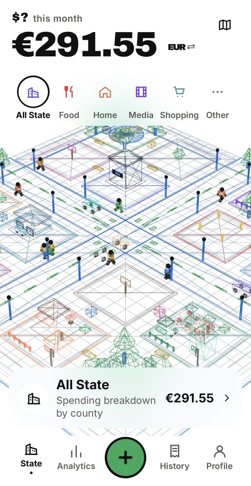
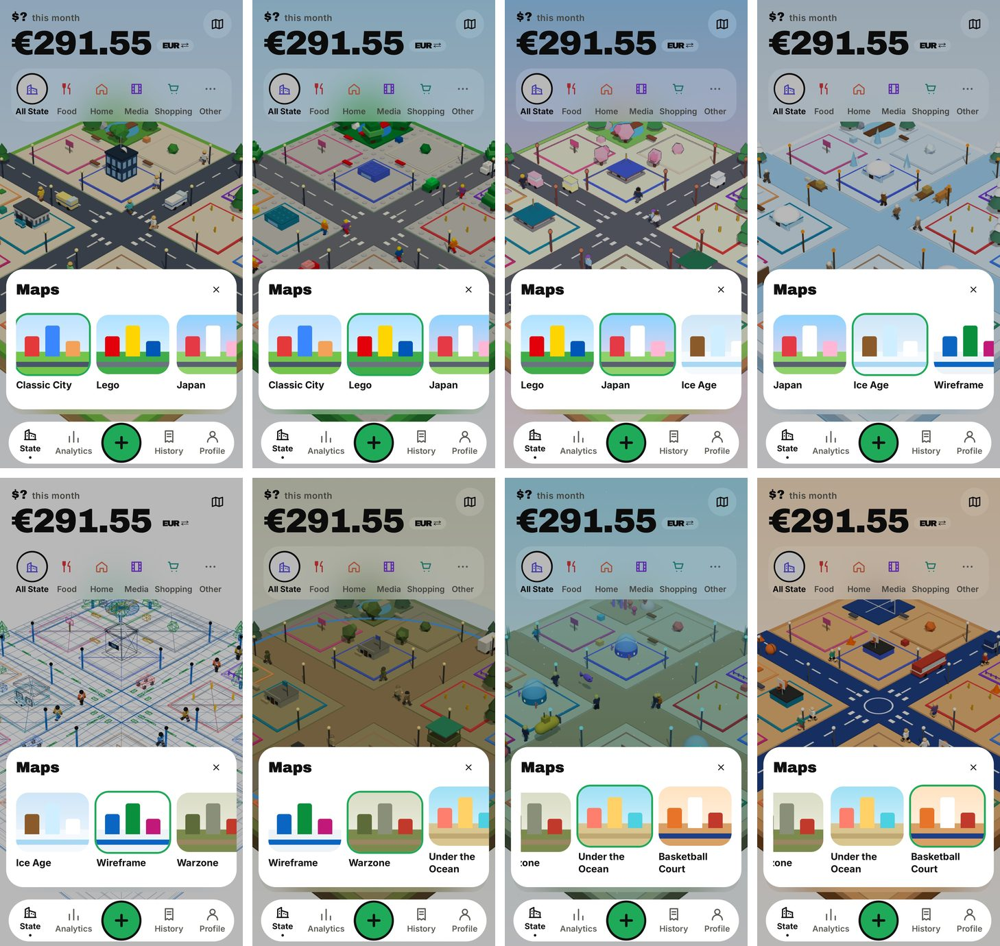
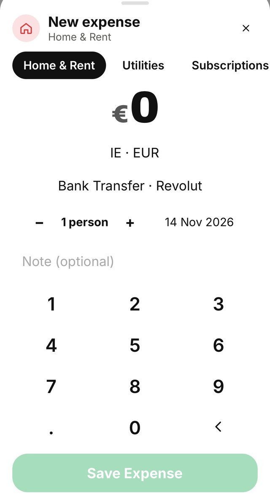
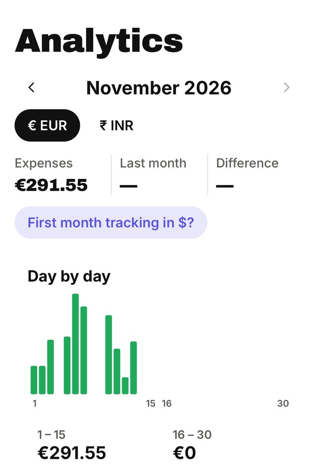
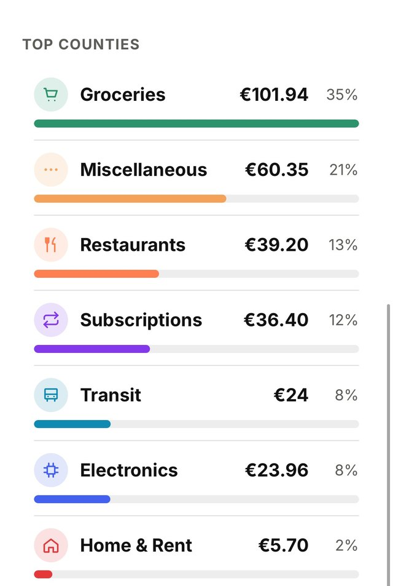
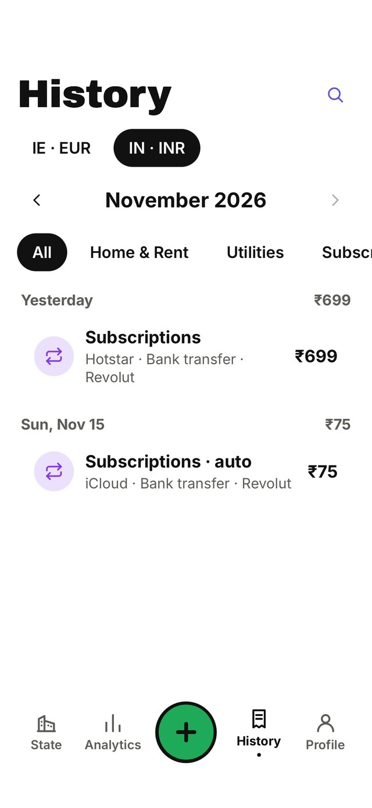
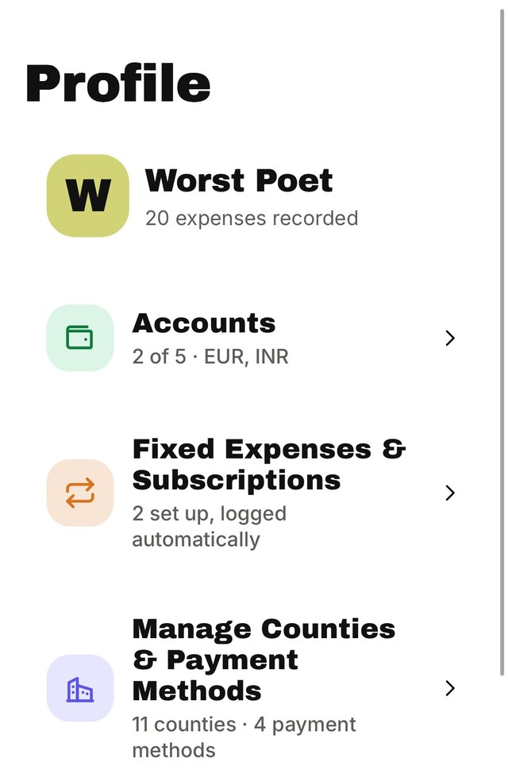
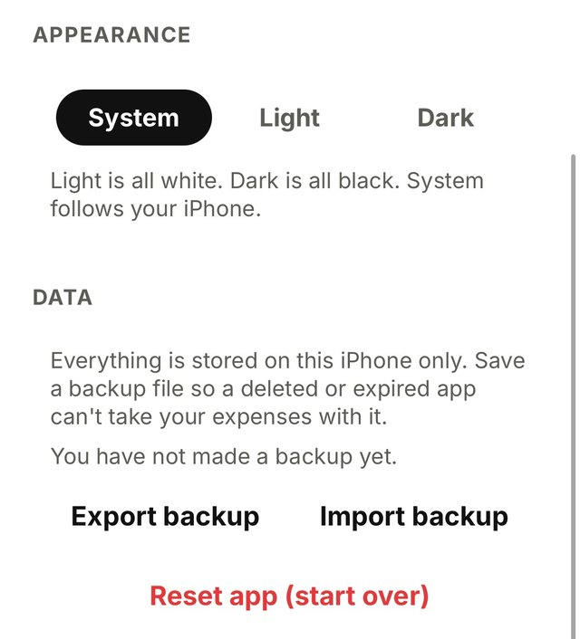

# $?

*(did I spend?)*

[](https://github.com/worstpoetGIT/dollar-q/actions/workflows/ci.yml)

<!-- screenshot: hero, the home map with a few buildings grown -->

### App Idea

Apps like Splitwise, Revolut, etc., can be expense trackers only to an extent. I got bored of subscribing to different money tracking apps, not because I'm afraid of where my money is going. So I decided to build my own expense tracker, and I named it "$?" (which means did I spend?).

You put in the expenses you make, under different categories, with different payment methods, for how many people that expense was made, and in different currencies, to keep track of, of course, where your money is going! I built it myself because I'm broke, and because I'm broke I didn't want to pay for subscriptions or for an Apple developer account. There's no option to set a budget in this app, so instead of noting expenses down on Notepad, I tried to build this!

Everything you type stays on your phone. There's no server, no account, no login, no ads.

### Opening the app

The first screen asks you to name your state, let's say Worst Poet's State. The sign on the house stays blank until you start typing, and then it says *Welcome to the state of* whatever you typed. Instead of "Continue", the button says **"Enter without Roaming charges"**.

<!-- screenshot: name screen with a name typed -->

After that the app asks you to set up four things, one at a time:

1. **Counties**: your categories of expenditure. There are 12 to start with and you can rename, regroup, add and delete them (maximum 12).
2. **Payment cultures**: how you pay. Bank Transfer, Debit Card, Credit Card, Cash, with a maximum of 5 sub-items for each (Bank 1, Bank 2, Card 1, Card 2...).
3. **Accounts**: maximum 5, each with only one currency. Say I spend in EUR and INR, then I create two accounts and log both under the same state.
4. **Fixed expenses**: you can skip this one.

### Home Page

The home page is a map of your state, filled with counties. The default counties are:

1. Home & Rent
2. Utilities
3. Subscriptions
4. Banking
5. Groceries
6. Restaurants
7. Cafes
8. Transit
9. Miscellaneous
10. Entertainment
11. Electronics
12. Fashion

On top there are circles which filter the counties:

1. Food: Restaurants, Groceries, Cafes
2. Home: Rent, Utilities
3. Media: Subscriptions, Entertainment
4. Shopping: Fashion, Electronics
5. Other: whatever is left

The whole map is made with Three.js, and the smooth scrolling on the other pages comes from Lenis. The map can be turned any way you like with one finger, zoomed with two fingers, and tapping a county shows a card with **Add** and **History**. The two round buttons in the top right are the **map picker** and the **appearance button**, which cycles System, Light and Dark (Light is all white, Dark is all black). The card at the bottom says **"All State"**, *Spending breakdown by county*.

<p align="center"></p>
<!-- screenshot: a county selected, with the bottom card -->

**The buildings grow.** When you add an expense, that county's building doesn't just pop up bigger, it gets constructed slowly, with a crane on the lot. A small amount gets a small upgrade (an empty plot, then a foundation, then a hut, then a proper building, then a fence and a flag). A bigger amount keeps going: extra buildings next to it, then more floors, and there's no maximum height. So the amount I enter decides how big the county gets. At the start of every month, all the counties go back to empty plots.

**There are people and vehicles.** People walk around the streets, really moving their arms and legs, and cars, buses and vans drive in from one end of the road and leave from the other.

**Maps.** The button on the top right changes the whole map, everything on it, the ground, the buildings, the vehicles, the people, the trees and the sky:

1. Classic City
2. Lego
3. Japan (anime look)
4. Ice Age
5. Wireframe
6. Warzone
7. Under the Ocean
8. Basketball Court

<p align="center"></p>

### Adding an expense

The big **+** in the middle opens a number pad. You pick the county, the account (which sets the currency), the payment method, how many people the expense was for, the date, and an optional note. Every tap has a little haptic.

**Splitting a bill.** If the expense was for 3 people, the app records only my equal share as my expense, the way Splitwise does it, because the other two pay me back. The whole amount is still written on the transaction, so History shows `Total €30 · 3 people` next to my €10. The county and the totals everywhere use my share, so they match what I actually spent.

**Splitting unevenly.** When the expense is for more than one person, an **Equally?** button appears. It opens two ways to split: **percentages** or **exact amounts**, both typed into boxes, with you as person 1. A bill of €50 between 3 people can be €16, €12 and €22. The split only saves when the whole bill is settled, to the cent, and only your part counts in your totals. History shows the whole math, for example `You €16 · Person 2 €12 · Person 3 €22`.

<p align="center"></p>

### Analytics Page

Analytics shows a graph of the expenses made in that month, with the days split into 1 to 15 and 16 to the end of the month. It also shows **last month** and the **difference** between last month and this month, the last 6 months, and the top counties.

<p align="center">&nbsp;&nbsp;</p>

### History

All the expenditures from the current month and previous months are in the History tab. You can go month by month, filter by county, or press the search button and type a keyword to search every month at once. To change or remove an expense, **swipe it to the left**: there is an **Edit** button and a **Delete** button. Edit opens the same number pad with everything filled in, so you can fix the amount, the people, the county, the payment method, the date or the note.

<p align="center"></p>

### Profile

1. **Accounts**: maximum 5, one currency each (12 currencies to choose from).
2. **Fixed Expenses & Subscriptions**: things like Claude or ChatGPT, where money is debited from your account on a specific day. Add them once and the app logs them every month, so you don't have to.
3. **Manage Counties & Payment Methods**: add, rename and delete counties and payment methods.
4. **Display**: a Minimalist mode switch that hides the phone's status bar (clock, signal, battery) while you are in the app.
5. **Data**: export a backup file and import it back. More on this below.

<p align="center">&nbsp;&nbsp;</p>

### What's not in the app, on purpose

- No budgets and no monthly goal.
- No income. This only tracks what you spend.
- No settings button, no streaks, no mini analytics.
- No account you have to make. Signing in with your email is optional, and the app works the same without it.

### Install

Download the files from the [Releases](../../releases) page.

**Android**

1. Download `DollarQ.apk` and open it. If Android asks, allow "install unknown apps" for your browser or file manager.
2. It's signed with one fixed key, so later versions install over the top and your data stays.

**iPhone**

The iPhone file is **not signed**, because Apple only lets you run signed apps and I'm not paying them for that. You sign it yourself with a sideloading tool and your own free Apple ID. I use [AltStore](https://altstore.io).


**How I keep it signed.** I don't redo that by hand every week. I run [AltServer](https://altstore.io) on a Raspberry Pi at home, signed in with my Apple ID. Whenever my iPhone is connected to my home network, the server re-signs the app in the background before the 7 days run out. If you don't have a machine that stays on at home, installing over the top again by hand every week is the way.

### Where your data lives

On your phone, in a database. If you delete the app, the data goes with it, so use **Profile, Data, Export backup** now and then. It makes a `.json` file you can save to Files or AirDrop to yourself, and **Import backup** brings everything back. Importing asks you before it replaces anything and keeps one undo.

**Signing in is optional.** If you sign in with your email (you get a 6 digit code, no password), your expenses sync between your phones and you get them back if you lose one. Then a copy of your data is also on my server in Ireland-region Oracle Cloud, in a PostgreSQL database that is backed up every hour, encrypted. Only your own account can read it, and **Profile, Account** can delete the account and the copy for good. The data on your phone stays. If two phones change the same expense, the newest edit wins.

### Tech Stack

| Part | What I used |
|---|---|
| UI | React 19, plain JavaScript (no TypeScript, no router, no state library) |
| Build | Vite 8 |
| 3D map | Three.js 0.187, used directly (no React wrapper) |
| Smooth scrolling | Lenis |
| Styling | One CSS file with CSS variables for the themes, fonts bundled with Fontsource (Archivo Black, Inter) |
| Phone shell | Capacitor 8, for Android and iPhone |
| Native plugins | Haptics, Preferences, Filesystem, Share, Status Bar |
| Tests | Vitest |
| Storage | SQLite on the phone (`@capacitor-community/sqlite`), with the old saved copy kept as a mirror. A browser falls back to `localStorage` |
| Sign in and sync | Email codes and sync against my own small server: Node 22, Fastify, PostgreSQL, Caddy, on an Oracle Cloud free tier VM. Login emails go through Resend. The token lives in the Keychain or Android Keystore |
| CI | GitHub Actions. Tests and a web build on every branch and pull request, a dependency audit, CodeQL once a week, and on `main` an Ubuntu runner (Java 21, Gradle) builds the APK and a macOS runner (`xcodebuild`) builds the IPA. All actions are pinned to a commit |
| Targets | Android 7 and up (minSdk 24, target 36), iOS 15 and up |

The app works fully offline. The only network code is the optional sign in and sync (`src/sync/`), and it talks to one address, `api.fridayai.win`, which the content security policy allows and nothing else. If you never sign in, the app never makes a request.

### How it works

**State and storage.** One small store (`src/store.js`) built on React's `useSyncExternalStore`. The whole app state is a single JSON object saved under the key `dollar-q:v1`:

```
{ v, entered, setupDone, stateName, appearance, map, currency,
  counties[], methods{ bank[], debit[], credit[], cash },
  accounts[], expenses[], fixed[] }
```

Limits: 12 counties, 5 accounts, 5 items per payment type, 50 fixed expenses, 50,000 expenses, and an amount of up to 999,999,999.99. Every time the state is loaded, it goes through `sanitize()`, which checks each field against what the app can actually produce and drops or resets anything else. In the installed app the state is also written to native storage, which iOS does not clear the way it can clear web storage.

**The map.** `src/CityScene.js` is a plain class, React only gives it a `<div>`. It owns the renderer, the camera, `OrbitControls` (turn, zoom, pan), a raycaster for tapping counties, and the render loop, which stops when you leave the tab. Nothing is loaded from a file: every building, tree, car and person is built in code from boxes, cylinders and cones, and the only textures are drawn on a canvas (the windows). The board is 30 x 30 with a crossing road, 12 lots for counties and 4 decoration cells.

**Map skins.** `src/maps.js` holds a recipe for each map: the palette, the buildings, the empty-plot structure, the pool of vehicles, the landmarks, the tree style, the outfits, the lighting, the fog and the particles. Changing the map throws away the whole world group and builds it again from the new recipe, which is why everything changes together. Japan uses toon materials plus an outline pass for the anime look, and Wireframe swaps its line colours between Light and Dark.

**Construction.** `levelFor()` in `src/util.js` turns a county's spending this month into a level, with no ceiling (about 2.5 levels per 20 EUR, easing off for very large totals, and each currency has its own rough scale). `plan(level)` in the scene says what stands on the lot at that level: the sign, the foundation, the hut, the main building, the fence and flag, then extra buildings and more floors taking turns. When a new expense raises the level, only the pieces that changed are built, and each one grows in on a timer while a crane turns on the lot.

**People and vehicles.** The people are small rigs with legs and arms that swing as they walk. Vehicles come from a pool, enter at one end of a road, keep a distance from the one in front, and leave at the other end.

**Haptics.** In the installed app it uses the native Taptic Engine (light for ordinary taps, medium for the main actions). In a browser it falls back to the single gentle tick that iOS Safari allows.

**Backups.** Export writes `{ app, format, exportedAt, data }` to a `.json` file and opens the share sheet. Import treats the file as untrusted: it checks the shape, runs the data through `sanitize()`, asks before replacing anything, and keeps one undo copy.

### Project layout

```
src/
  main.jsx            entry point, crash guard
  App.jsx             tabs and screens
  store.js            state, validation, persistence
  CityScene.js        the 3D map (Three.js)
  maps.js             the map skins
  backup.js           export and import
  haptics.js          native and web haptics
  util.js             currencies, formatting, the level function
  components/         Home, Analytics, History, Profile, AddSheet, SplitPanel, Account, Onboarding, Splash...
  db/                 the SQLite tables and the code that turns the state into rows and back
  sync/               sign in, and the sync engine (send changes, fetch changes, newest edit wins)
  traffic.js          who drives and walks where, and how big a lot is for a county's level
android/              Capacitor Android project
ios/                  Capacitor iOS project
build-ios.sh          unsigned IPA build for a Mac
.github/workflows/    CI (tests, audit), CodeQL, and the app builds
tools/                signs and publishes a release on my own machine
docs/screenshots/     the pictures in this README
```

### Testing

`npm test` runs an automated suite (Vitest) in a couple of seconds, and the build runs it first on every push. It covers:

- **Data validation** (`sanitize`): garbage, wrong types, fake colours and icons, huge or negative amounts, duplicate ids, prototype pollution, and the conversion of old expenses into shares.
- **The split**: my share of a bill, rounding to cents, and that converting twice changes nothing.
- **Construction levels**: the level never drops as the amount grows, has no ceiling, scales per currency, and every level adds something to the lot.
- **Add, edit and delete** of an expense, and **reading backup files**, including hostile ones.
- **The database**: moving the old saved data over (and verifying it), upgrading older database versions, and what happens when a write fails.
- **Sync**: sending and fetching changes, newest edit wins, deletes, two phones, going offline, and never overwriting what someone is typing.
- **Uneven splits**: percentages and exact amounts, the cents always adding up to the bill, bad splits being refused, and the phone and the server splitting cents identically.
- **Footpaths**: lot size by level, the footpath thinning as a county grows, and long simulations checking that nobody touches, stands on a line or leaves the pavement.
- **Guards**: the page's security policy must allow the server address (and nothing wider), and the version must match in `package.json`, Android and Xcode.

The 3D map, the animations, the haptics and the installs are not covered by tests. I check those in a headless browser and on my own iPhone. The Android APK is built and signed, but I have not run it on an Android device yet, so treat it as untested.

### Security

I tried to attack my own app before sharing it, and fixed what I found:

- Everything saved on the phone is checked every time the app opens (types, lengths, allowed values, size limits), so a broken or edited backup can't crash it or sneak anything in.
- A strict content security policy only lets the app run its own code and talk to nothing else.
- Imported backup files are treated as untrusted, and shown to you before they replace anything.
- Android's cloud backup is switched off.
- The server never trusts the phone: it checks every record again and works out each share itself. Login codes are stored hashed and expire after 10 minutes, sessions are opaque tokens whose hash is stored, and there are rate limits on codes and requests.
- Dependencies are audited on every change, the code is scanned with CodeQL, and the build tools are pinned to exact commits.

If you find something I missed, open an issue.

### Build it yourself

You need Node 22 or newer.

```bash
npm ci
npm run dev          # preview in the browser
npx vite build       # web build into dist/
```

The Android and iPhone builds run on GitHub Actions (`.github/workflows/build.yml`), because my MacBook doesn't have the space for Xcode. They produce two unsigned files:

- **Android:** `npx cap sync android`, then `./gradlew assembleRelease` inside `android/`. I sign the APK on my own machine with a key that never gets uploaded anywhere. To sign your own build: `zipalign -c 4 app.apk`, then `apksigner sign --ks your.p12 --out DollarQ.apk app.apk`.
- **iPhone:** `npx cap sync ios`, then `./build-ios.sh` on a Mac with Xcode. It gives you the unsigned `.ipa`.

**How a release goes out.** Pushing a tag like `v0.3.1` builds both files and opens a **draft** release with the unsigned APK and IPA. The tests also check that the tag matches the version in `package.json`, the Android settings and the Xcode project. Then I run `tools/sign-and-release.sh v0.3.1` on my own machine. It signs the APK with my key, checks the certificate is the same as every earlier release (phones refuse an update otherwise), and uploads it. It only goes public when I add `--publish`. The signing key never leaves my machine and is not a GitHub secret.

### Contributors

- [worstpoetGIT](https://github.com/worstpoetGIT)
- [asif-reh](https://github.com/asif-reh)

### License

[MIT](LICENSE)
